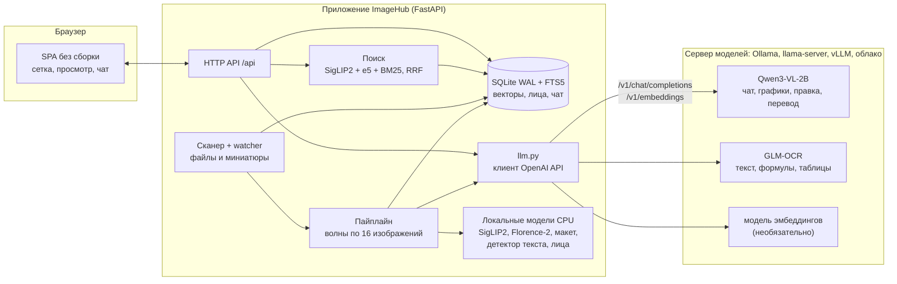

# Мультимодальный просмотр фото на компактной VLM (ImageHub)

[](https://github.com/vladimirannenkov/multimodal-photo-viewer-compact-vlm/actions/workflows/ci.yml)

Работа выполнена в рамках проекта по дисциплине «Программные средства для задач искусственного интеллекта».

## Содержание

1. [Задача](#задача)
2. [Возможности](#возможности)
3. [Запуск одной командой](#запуск-одной-командой)
4. [Архитектура](#архитектура)
5. [Обоснование архитектурных решений](#обоснование-архитектурных-решений)
6. [Модели и серверы моделей](#модели-и-серверы-моделей)
7. [Настройки](#настройки)
8. [Разработка](#разработка)
9. [Тестирование](#тестирование)
10. [Логирование](#логирование)
11. [Непрерывная интеграция](#непрерывная-интеграция)
12. [Известные ограничения](#известные-ограничения)
13. [Как пользоваться](#как-пользоваться)
14. [Горячие клавиши и темы](#горячие-клавиши-и-темы)
15. [HTTP API](#http-api)

## Задача

Личная фотоколлекция быстро превращается в свалку файлов: по имени `IMG_4821.jpg` не понять, что на снимке, текст на скриншотах и чеках не найти, а график обучения нейросети, сохранённый неделю назад, приходится искать вручную.

ImageHub — локальный сервис, который индексирует папки с изображениями и позволяет их искать и просматривать:

- описывает сцену, находит объекты и определяет тип снимка (фото, документ, чек, скриншот, график);
- распознаёт текст, формулы (LaTeX) и таблицы (Markdown) и исправляет ошибки распознавания;
- находит лица и ведёт общую базу людей;
- ищет по смыслу, по тексту на изображении, по картинке-образцу и по их смеси, на русском и английском;
- отвечает на вопросы по выбранной картинке в чате;
- разбирает графики метрик (максимум, плато, лучшая серия) и группирует их по экспериментам.

Все модели не больше 3 млрд параметров, работают на процессоре и укладываются в 24 ГБ памяти. Данные остаются на вашем компьютере.

## Возможности

- **Импорт.** Папки (с быстрой проверкой новых файлов и слежением), отдельные файлы, перетаскивание, вставка из буфера обмена. Форматы: jpg, png, webp, gif, tif (в том числе многокадровые), bmp, heic, avif.
- **Текст.** Детектор текста и языка, затем OCR с формулами и таблицами, правка опечаток. Переключатель «Отрендеренный / Исходный Markdown / До правки».
- **Сцена.** Описание на русском и английском, объекты с координатами, тип снимка и событие, теги и категории.
- **Лица.** Глобальная база людей, разметка в чате: рамка подсвечивается, сервис предлагает варианты, вы отвечаете именем.
- **Поиск.** Гибридный: эмбеддинги изображений, эмбеддинги описаний и BM25 по описанию и OCR, объединение через RRF.
- **Чат.** Вопросы к выбранной картинке, ответ потоком, Markdown с формулами. У каждой картинки свой чат.
- **Эксперименты.** Графики метрик превращаются в ряды данных, максимум и плато считаются кодом, а не «выдумываются» моделью.
- **Просмотр.** Лупа, поворот, рамки, стрелки, подписи, кадрирование (всегда копией), сравнение двух изображений, отмена и возврат.
- **Каталог.** Коллекции, категории, избранное, фильтры, дубликаты, экспорт и склейка N×M.

## Запуск одной командой

Нужны Docker с Compose v2 и около 8 ГБ свободного места. Видеокарта не нужна.

```bash
git clone https://github.com/vladimirannenkov/multimodal-photo-viewer-compact-vlm.git
cd multimodal-photo-viewer-compact-vlm
docker compose up --build
```

Откройте http://localhost:8765. Первый запуск скачивает модели (около 4 ГБ: Qwen3-VL-2B и GLM-OCR в Ollama, SigLIP2, Florence-2 и вспомогательные модели), поэтому занимает несколько минут. Последующие запуски стартуют за секунды.

Своя папка с фотографиями подключается переменной `IMAGEHUB_PHOTOS` (в приложении она видна как `/photos`):

```bash
IMAGEHUB_PHOTOS=/путь/к/фото docker compose up --build
```

Проверить связь приложения с сервером моделей:

```bash
docker compose run --rm imagehub check
```

Что запускает Compose:

| Сервис | Назначение |
|---|---|
| `ollama` | сервер языковых моделей с OpenAI-совместимым API (`:11434/v1`) |
| `ollama-pull` | однократно загружает в Ollama `qwen3-vl:2b-instruct` и `glm-ocr` |
| `weights` | однократно скачивает небольшие модели, которых нет в Ollama (SigLIP2, Florence-2, макет страницы, лица) |
| `imagehub` | приложение и веб-интерфейс |

### Без Docker

Нужны Python 3.11+ и [uv](https://docs.astral.sh/uv/).

```bash
uv sync --extra ml                       # зависимости по uv.lock, включая локальные модели (PyTorch для CPU)
ollama pull qwen3-vl:2b-instruct && ollama pull glm-ocr
uv run imagehub models --download --only siglip2,florence2,ppocr_v5_det,ppocr_eslav_rec,doclayout_yolo
uv run imagehub check                    # сервер моделей отвечает и нужные модели на нём есть
uv run imagehub serve                    # http://127.0.0.1:8765
```

## Архитектура



Обработка изображения идёт по стадиям: `embed` (SigLIP2: вектор, тип, событие) → `textdet` (детектор текста) → `scene` (Florence-2: описание, объекты) → `ocr` (макет страницы и GLM-OCR) → `faces` → `fix` (правка опечаток) → `translate` (перевод описания) → `chart` (разбор графика) → `textemb` (эмбеддинги текста) и обновление полнотекстового индекса.

Структура репозитория:

```
src/imagehub/
  config.py logs.py cli.py             настройки (переменные окружения), JSON-логи, командная строка
  llm.py                               клиент OpenAI-совместимого API: чат, потоковый ответ, эмбеддинги
  scanner.py watcher.py db.py          каталог, слежение за папками, SQLite
  pipeline.py                          фоновая обработка волнами, стадии
  search.py queries.py people.py       гибридный поиск, фильтры, база лиц
  ml/                                  адаптеры моделей: vlm.py (диспетчер сервер/локально), vqa.py, textfix.py, ...
  api/                                 FastAPI: library, meta, faces, chat, tools
  web/static/                          интерфейс без сборки
tests/                                 pytest: unit, API, пайплайн с заглушками, интеграционные (slow)
model_lab/                             стенд сравнения моделей
.github/workflows/ci.yml               CI: ruff, mypy, pytest на Python 3.11–3.13, сборка Docker
```

## Обоснование архитектурных решений

| Решение | Почему |
|---|---|
| **Языковые модели только по HTTP, OpenAI-совместимый API** (`llm.py`) | Требование проекта и практичное решение: один и тот же код работает с Ollama, `llama-server`, vLLM на GPU в Colab/Kaggle и облачными провайдерами. Переключение — переменные окружения (`IMAGEHUB_LLM_BASE_URL`, `IMAGEHUB_LLM_MODEL`), код не меняется. Тесты подменяют сервер моком. |
| **Ollama по умолчанию** | Работает на CPU на любой ОС, ставится одной командой, сам загружает и выгружает модели, так что 24 ГБ памяти хватает на Qwen3-VL-2B и GLM-OCR по очереди. Из вариантов «Ollama / llama.cpp» выбран тот, что требовал минимума изменений: он даёт тот же API и готовые образы для Compose. |
| **Одна универсальная модель Qwen3-VL-2B** для чата, графиков, правки опечаток и перевода | Вместо отдельной текстовой модели: меньше памяти и один сервер. Правки защищены проверками: формулы заменяются метками, ответ ограничен по длине, похожесть на исходный текст проверяется, выдумки отбрасываются. |
| **Специализированные модели остаются локальными** (SigLIP2, Florence-2, макет, детектор текста, InsightFace) | Это не чат-модели: у них нет OpenAI-совместимого API и в Ollama их нет. Они небольшие, работают на CPU, а SigLIP2 нужен ещё и при поиске (мгновенный текстовый запрос без сети). |
| **Двухступенчатый OCR**: детектор текста на CPU отсекает картинки без текста, затем макет страницы и OCR-модель по блокам | Дешёвая проверка избавляет от запуска VLM на каждом фото. Разбор по блокам даёт формулы и таблицы в правильном формате. |
| **Числа считает код, а не модель** | Максимум, плато и лучшая серия на графике вычисляются по точкам, которые извлекла модель. Это исключает «галлюцинации» в цифрах. |
| **SQLite (WAL) + FTS5 + матрица векторов в памяти** | Ноль внешних сервисов, надёжное хранение, BM25 «из коробки». Для десятков тысяч картинок точный поиск по матрице быстрее и проще, чем ANN-индекс. |
| **Гибридный поиск через RRF** | Эмбеддинги изображений хорошо находят объекты, BM25 — точные слова и числа, эмбеддинги описаний — смысл. Объединение по рангам не требует калибровки оценок. |
| **Обработка волнами по 16 изображений** | Модели переключаются редко, а пользователь видит результат постепенно. Чат пользователя имеет приоритет над очередью. |
| **SPA без сборки + API без бизнес-логики в интерфейсе** | Нет Node-зависимостей; тот же API подойдёт для другого клиента. |
| **Ядро без torch**, тяжёлые библиотеки в extra `ml` | Тесты и CI не скачивают гигабайты, а модуль `llm.py` и каталог работают сами по себе. |

## Модели и серверы моделей

| Задача | Модель | Где работает |
|---|---|---|
| Чат, разбор графиков, правка опечаток, перевод описаний | Qwen3-VL-2B (`qwen3-vl:2b-instruct`, 1,9 ГБ) | сервер моделей |
| OCR: текст, формулы, таблицы | GLM-OCR 0.9B (`glm-ocr`) | сервер моделей |
| Эмбеддинги описаний (необязательно) | любая модель для `/v1/embeddings`, например `bge-m3` | сервер моделей |
| Эмбеддинги изображений, тип и событие, поиск | SigLIP2 base | локально, CPU |
| Описание сцены, объекты | Florence-2-large | локально, CPU |
| Детектор текста, макет страницы | PP-OCRv5 и DocLayout-YOLO (ONNX) | локально, CPU |
| Лица | InsightFace buffalo_l | локально, CPU |
| Эмбеддинги описаний по умолчанию | multilingual-e5-small | локально, CPU |
| OCR таблиц и формул (необязательно) | PaddleOCR-VL 0.9B | локально, `IMAGEHUB_OCR_LOCAL_PADDLE=true` |

Способы запуска сервера моделей:

| Способ | Настройки |
|---|---|
| Ollama (по умолчанию) | `IMAGEHUB_LLM_BASE_URL=http://localhost:11434/v1`, `IMAGEHUB_LLM_MODEL=qwen3-vl:2b-instruct` |
| llama.cpp | `llama-server -m Qwen3-VL-2B-Instruct-Q4_K_M.gguf --mmproj mmproj.gguf --port 8080`, затем `IMAGEHUB_LLM_BASE_URL=http://localhost:8080/v1` |
| vLLM на GPU в Colab/Kaggle | `vllm serve Qwen/Qwen3-VL-2B-Instruct`, доступ через ngrok или cloudflared: `IMAGEHUB_LLM_BASE_URL=https://<id>.ngrok-free.app/v1`, `IMAGEHUB_LLM_MODEL=Qwen/Qwen3-VL-2B-Instruct` |
| Облачный API (OpenRouter, Groq) | другой `IMAGEHUB_LLM_BASE_URL`, `IMAGEHUB_LLM_API_KEY` и `IMAGEHUB_LLM_MODEL` провайдера |

Для сервера без OCR-модели задайте `IMAGEHUB_OCR_MODEL=` (пусто): блоки текста будет читать локальная GLM-OCR из каталога весов (`imagehub models --download --only glm_ocr`). Если OCR-модели на сервере нет, а Qwen3-VL подходит, можно указать её же: `IMAGEHUB_OCR_MODEL=<та же модель>`.

## Настройки

Переменные окружения с префиксом `IMAGEHUB_` (можно положить в `.env`, образец в `.env.example`):

| Переменная | По умолчанию | Смысл |
|---|---|---|
| `LLM_BASE_URL` | `http://localhost:11434/v1` | адрес сервера с OpenAI-совместимым API |
| `LLM_API_KEY` | `ollama` | ключ (локальным серверам любой) |
| `LLM_MODEL` | `qwen3-vl:2b-instruct` | модель для чата, графиков, правки и перевода |
| `OCR_MODEL` | `glm-ocr` | OCR-модель на сервере; пусто: локальные веса |
| `OCR_LOCAL_PADDLE` | `false` | таблицы и формулы читает локальная PaddleOCR-VL |
| `EMBED_MODEL` | пусто | модель для `/v1/embeddings`; пусто: локальная e5-small |
| `LLM_TIMEOUT`, `LLM_RETRIES`, `LLM_CONCURRENCY` | `300`, `3`, `2` | таймаут запроса, повторы, параллельные запросы |
| `DATA_DIR` | `./data` | база SQLite, миниатюры, производные файлы |
| `WEIGHTS_DIR` | `./weights` | веса локальных моделей |
| `PICTURES_DIR` | `~/Pictures/ImageHub` | сюда сохраняются вставки и загрузки |
| `DEVICE` | `auto` | `cpu` или `cuda` для локальных моделей |
| `OCR_FIX` | `true` | правка опечаток после OCR |
| `HOST`, `PORT` | `127.0.0.1`, `8765` | адрес сервиса |
| `LOG_LEVEL`, `LOG_JSON` | `INFO`, `true` | уровень и формат логов |

Команды: `imagehub serve [--host --port]`, `imagehub scan <папка>`, `imagehub models [--download] [--only id,id]`, `imagehub check` (проверка сервера моделей; код возврата 1, если чего-то не хватает).

## Разработка

```bash
uv sync                           # ядро + dev-инструменты по uv.lock
uv run pre-commit install         # проверки при каждом коммите
uv run ruff check . && uv run ruff format --check .
uv run mypy
uv run pytest                     # порог покрытия 70% включён
```

Менеджер зависимостей — uv, версии зафиксированы в `uv.lock`. Линтер и форматирование — Ruff (включая запрет `print` в рабочем коде), типы — mypy (новые модули `llm`, `logs`, `cli`, `config` проверяются строго), автоматизация — pre-commit.

## Тестирование

- **pytest** с фикстурами (`env` изолирует каталоги и БД, `photos` создаёт изображения, `llm_server` — мок сервера моделей, `fake_models` — заглушки нейросетей), параметризацией и маркерами.
- **Сервер моделей всегда замокан** через [respx](https://lundberg.github.io/respx/): проверяются тело запроса, повторы при 5xx, потоковый ответ, ошибки, разбор ответов. Ни один обычный тест не ходит в сеть.
- **Пайплайн** целиком проходит все стадии на заглушках SigLIP2/Florence-2/OCR и моке сервера.
- **Покрытие** — 83% при пороге 70% (`--cov-fail-under` в `pyproject.toml`). Из подсчёта исключены тонкие адаптеры нейросетей, которым нужны веса (`siglip`, `florence`, `faces`, `layout`, `textdet`); они проверяются вручную и интеграционными тестами.
- **Интеграционные тесты** с настоящей компактной моделью помечены `@pytest.mark.slow` и по умолчанию не запускаются:

```bash
ollama pull qwen3-vl:2b-instruct
uv run pytest -m slow --no-cov      # без запущенного Ollama тесты пропускаются
```

## Логирование

Все записи — структурированные JSON-строки в stderr (по одной на запись): время, уровень, логгер, сообщение и дополнительные поля, при ошибке — трассировка. `print` в рабочем коде запрещён правилом Ruff `T20`; результаты CLI-команд идут в stdout, диагностика — в логи.

```json
{"ts": "2026-10-21T12:00:00.123Z", "level": "INFO", "logger": "imagehub.llm", "msg": "llm chat", "model": "qwen3-vl:2b-instruct", "sec": 4.21, "chars": 188}
```

Логи uvicorn идут тем же путём. Формат `IMAGEHUB_LOG_JSON=false` включает обычный текст для отладки.

## Непрерывная интеграция

GitHub Actions (`.github/workflows/ci.yml`) на каждый push и pull request:

1. `lint`: `ruff check`, `ruff format --check`, `mypy`;
2. `test`: pytest с покрытием на **Python 3.11, 3.12 и 3.13** (матрица), зависимости по `uv.lock`;
3. `docker`: проверка `docker-compose.yml` и сборка Docker-образа.

## Известные ограничения

- **Скорость на CPU.** Qwen3-VL-2B в Ollama без GPU отвечает за секунды-десятки секунд, OCR страницы дольше. Индексация сотен фотографий идёт в фоне и занимает часы. С GPU на сервере моделей (vLLM в Colab, Ollama с CUDA) быстрее многократно.
- **Память.** Рассчитано на RAM до 24 ГБ: Ollama держит одну-две модели, приложение с локальными моделями занимает 2–4 ГБ.
- **Диск.** Около 4 ГБ на модели и 3 ГБ на образ приложения.
- **Внешние сервисы.** Нужен сервер с OpenAI-совместимым API (Ollama и др.). Без него работают каталог, просмотр и поиск по уже построенному индексу, а чат, OCR, правка и перевод возвращают понятную ошибку. Хранилище моделей Hugging Face нужно один раз для скачивания весов.
- **Таблицы и формулы.** PaddleOCR-VL в Ollama нет, поэтому по умолчанию их читает GLM-OCR; включить локальную Paddle можно настройкой `OCR_LOCAL_PADDLE`.
- **Смена модели эмбеддингов** меняет размерность векторов: векторы описаний нужно пересчитать (`DELETE FROM vectors WHERE kind='txt'` и повторная обработка).
- **Качество 2B-моделей.** Описания, перевод и OCR рукописного текста иногда ошибаются; поэтому правки опечаток защищены проверками, а числа на графиках считает код.
- **Лица.** Лицензия весов InsightFace допускает только некоммерческое использование.
- **Безопасность.** Сервис не имеет авторизации и по умолчанию слушает только `127.0.0.1` (в Docker — `0.0.0.0` внутри контейнера, порт публикуется на хост).
- Проверено на Windows 11 и в Linux-контейнерах; macOS не проверялся.

## Как пользоваться

1. Откройте http://localhost:8765. Кнопка добавления папки открывает обзор каталогов сервера (в Docker папка с фото — `/photos`). Миниатюры появятся сразу, обработка идёт в фоне.
2. Индикатор очереди вверху показывает стадию и прогресс; очередь можно поставить на паузу. Открытая картинка и вставка из буфера обрабатываются вне очереди.
3. **Вставка.** `Ctrl+V` сохраняет картинку в `PICTURES_DIR/clipboard`. Если фокус в строке поиска, картинка станет образцом для поиска.
4. **Поиск.** Введите слова на русском или английском, добавьте картинку и регулируйте вес текста ползунком. «Найти похожие» есть в контекстном меню.
5. **Правая панель.** Вкладки «Описание» (переключатель языка), «Текст» (переключатель рендера), «Лица», «Чат», «Файл».
6. **Лица.** Разметка идёт диалогом: лицо показывается крупно, предлагаются варианты (известные люди, роли «прохожий», «студент»).
7. **Графики.** Вставьте график из буфера: он получит тип «график», попадёт в эксперимент, а слева появятся максимум и плато по данным.
8. **Правка.** Рамки, стрелки, подписи, кадрирование; «Разметка в копию» сохраняет результат отдельным файлом, оригинал не меняется.
9. **Контекстное меню** (правый клик): избранное, категории, коллекции, эксперимент, склейка N×M, экспорт, копирование, переименование, повторная обработка, удаление.

## Горячие клавиши и темы

В каталоге: `/` поиск, `Ctrl+V` вставка, `Ctrl+A` выделить всё, `Ctrl+C` копировать изображение, `F` избранное, `F2` переименовать, `Del` удалить, `Enter` открыть.

В просмотре: `←` `→` листание, `+` `-` масштаб, `0` по размеру, `1` 100%, `R` поворот, `L` лупа, `C` сравнение, `Ctrl+Z` отменить, `Ctrl+Y` вернуть, `Esc` выход.

Тема выбирается в меню или параметром адреса: `/?theme=ocean` (также `forest`, `sand`, `rose`, `graphite`, `midnight`, `nord`, `violet`). Галерея: `/themes`.

## HTTP API

Интерфейс не содержит бизнес-логики, всё идёт через API (`/api`), документация OpenAPI на `/docs`. Основные группы: `/api/images`, `/api/search`, `/api/import/*`, `/api/queue`, люди и лица, `/api/images/{id}/chat` (потоковый ответ), `/api/experiments`, `/api/collections`, `/api/categories`, `/api/merge`, `/api/export`. Проверка живости: `GET /api/health` (`?deep=true` дополнительно опрашивает сервер моделей).
