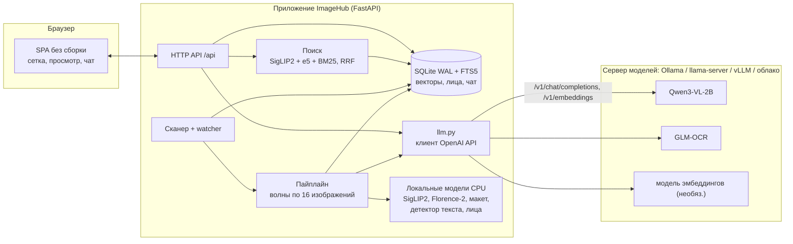

# Технический отчёт: «Мультимодальный просмотр фото на компактной VLM» (ImageHub)

Отчёт написан как исходный материал для презентации: каждый раздел самодостаточен, в конце каждого есть «тезисы для слайдов».
Проект выполнен в рамках дисциплины «Программные средства для задач искусственного интеллекта».
Репозиторий: https://github.com/vladimirannenkov/multimodal-photo-viewer-compact-vlm

---

## 1. Что за проект и зачем он нужен

### 1.1 Проблема
Личный фотоархив растёт быстрее, чем человек успевает его разбирать. По имени файла `IMG_4821.jpg` не понять, что на снимке. Текст на скриншотах, чеках и страницах документов невозможно найти поиском. Графики обучения нейросетей, сохранённые неделю назад, приходится открывать по одному. Облачные сервисы решают часть проблемы, но требуют отправлять личные фотографии на чужие серверы.

### 1.2 Решение
ImageHub — локальный сервис. Он индексирует папки с изображениями, понимает их содержимое с помощью компактных нейросетей (каждая не больше 3 млрд параметров) и даёт удобный интерфейс для поиска и просмотра. Данные остаются на компьютере пользователя, сервис слушает только `127.0.0.1`.

### 1.3 Ограничения постановки
- модели не больше 3B параметров;
- запуск на машине с RAM до 24 ГБ **без графического процессора**;
- обращение к языковым моделям **только через HTTP API, совместимый с OpenAI** (`/v1/chat/completions`, `/v1/embeddings`), адрес и модель задаются переменными окружения;
- в тестах и CI модели заменены моками, настоящая модель — только в тестах с маркером `slow`.

### 1.4 Что умеет система
| Функция | Как реализована |
|---|---|
| Импорт | Папки с быстрой проверкой новых файлов и слежением, отдельные файлы, drag-and-drop, вставка из буфера обмена |
| Описание сцены | Florence-2: подпись, объекты с рамками, теги; тип снимка и событие — SigLIP2 |
| Распознавание текста | Детектор текста → макет страницы → OCR-модель по блокам → Markdown с формулами LaTeX и таблицами |
| Правка опечаток OCR | Qwen3-VL-2B с защитой формул и проверками на выдумки |
| Лица | InsightFace (SCRFD + ArcFace), общая база людей, разметка в диалоге |
| Поиск | Гибридный: векторы изображений, векторы описаний, BM25; текст, картинка или их смесь; русский и английский |
| Чат | Вопросы к выбранной картинке, потоковый ответ, у каждой картинки своя история |
| Эксперименты | Графики метрик → ряды данных, максимум и плато считает код |
| Просмотр и правка | Лупа, поворот, рамки, стрелки, подписи, кадрирование копией, сравнение, отмена и возврат |
| Каталог | Коллекции, категории, избранное, фильтры, дубликаты, экспорт, склейка N×M |

**Тезисы для слайдов:** проблема «свалки фотографий» → локальный сервис → компактные модели, CPU, 24 ГБ → всё через OpenAI-совместимый API.

---

## 2. Архитектура

### 2.1 Общая схема



### 2.2 Слои и модули

| Слой | Файлы | Ответственность |
|---|---|---|
| Интерфейс | `web/static/` (ES-модули, KaTeX, markdown-it) | Отображение; бизнес-логики нет, всё через API |
| API | `api/app.py`, `library.py`, `meta.py`, `faces.py`, `chat.py`, `tools.py` | REST-эндпоинты, потоковый ответ чата, `/api/health` |
| Каталог | `scanner.py`, `watcher.py`, `imaging.py`, `db.py` | Обход папок, миниатюры, хеш, SQLite |
| Обработка | `pipeline.py` | Фоновая обработка волнами по стадиям |
| Поиск | `search.py`, `queries.py`, `people.py` | Гибридный поиск, фильтры, база лиц |
| Клиент моделей | `llm.py` | OpenAI-совместимый HTTP-клиент: повторы, потоки, эмбеддинги |
| Адаптеры | `ml/vlm.py`, `vqa.py`, `textfix.py`, `docparse.py`, `textembed.py`, … | Промпты, пост-обработка, диспетчер «сервер или локально» |
| Служебное | `config.py`, `logs.py`, `cli.py`, `models.py` | Настройки из окружения, JSON-логи, CLI, реестр весов |

### 2.3 Ключевое решение: диспетчер «сервер или локальные веса»
Все адаптеры вызывают единую функцию `vlm.generate(path, images, prompts, ...)`. Если `path` начинается с `api:`, запрос уходит на сервер моделей через `llm.py`; иначе загружаются локальные веса. Благодаря этому переход на Ollama потребовал минимум изменений: промпты, пост-обработка и защиты в `textfix`, `vqa`, `docparse` остались прежними, заменилась только «внутренность» вызова. Идентификатор модели берётся из `IMAGEHUB_LLM_MODEL`, поэтому смена Ollama на llama-server, vLLM или облако не требует правки кода.

### 2.4 Данные и хранение
- **SQLite в режиме WAL**: изображения, папки, категории (связь M:N), коллекции, люди, лица, эксперименты, чат, аннотации, векторы (BLOB).
- **FTS5** — полнотекстовый индекс по описанию, OCR-тексту и тегам (русским и английским).
- **Векторы** хранятся в БД и загружаются в память матрицей; точный поиск (произведение матриц) быстрее и проще ANN-индекса для десятков тысяч картинок.
- **Миниатюры** в webp; оригиналы не изменяются никогда: обрезка, склейка и аннотации создают копии.
- Версия пайплайна пишется в БД, чтобы переобрабатывать изображения выборочно.

### 2.5 Управление ресурсами
- Один замок на «тяжёлые» вызовы (`manager.gpu`): фоновый пайплайн и чат пользователя не грузят модели одновременно; **запрос пользователя имеет приоритет** над очередью.
- В памяти держится одна группа тяжёлых моделей (`ocr`, `scene`, `vqa`), SigLIP2 мал и остаётся резидентным.
- После выгрузки вызывается `trim_memory()` (пик процесса около 1 ГБ вместо 7 ГБ при ранней версии).
- Ядро проекта **не импортирует torch**: тяжёлые библиотеки вынесены в extra `ml` и подгружаются лениво. Поэтому тесты и CI не скачивают гигабайты.

**Тезисы для слайдов:** три блока (браузер / приложение / сервер моделей); диспетчер `api:` против локальных весов; SQLite+FTS5 без внешних сервисов; оригиналы неприкосновенны.

---

## 3. Пайплайн обработки изображения

### 3.1 Принцип: волны
Изображения обрабатываются **волнами по 16**. Одна группа моделей загружается один раз, через неё проходят все изображения волны, затем загружается следующая группа. Это экономит память и время загрузки. Пользователь видит результаты постепенно, индикатор показывает стадию и прогресс, очередь можно поставить на паузу. Открытая картинка и вставка из буфера обрабатываются вне очереди (приоритет).

### 3.2 Стадии

| № | Стадия | Что делает | Где выполняется |
|---|---|---|---|
| 1 | `embed` | SigLIP2: эмбеддинг изображения, zero-shot тип (фото, документ, чек, скриншот, график, диаграмма, формула, таблица, карта, мем) и событие | локально |
| 2 | `textdet` | PP-OCRv5 (ONNX): есть ли связный текст, число строк, язык по скрипту, поворот | локально, CPU |
| 3 | `scene` | Florence-2-large: подпись, объекты с рамками, регионы; только для не-документов | локально |
| 4 | `ocr` | Макет страницы (DocLayout-YOLO) → блоки → OCR-модель пакетами → Markdown | CPU + сервер моделей |
| 5 | `faces` | InsightFace: детекция, эмбеддинг, привязка к человеку | локально, CPU |
| 6 | `fix` | Правка опечаток OCR (Qwen3-VL-2B) | сервер моделей |
| 7 | `translate` | Перевод описания и тегов на русский (Qwen3-VL-2B) | сервер моделей |
| 8 | `chart` | Для графиков: извлечение рядов в JSON, вычисление статистики кодом, привязка к эксперименту | сервер моделей + код |
| 9 | `textemb` | Эмбеддинги текста (e5-small локально или `/v1/embeddings`), обновление FTS | локально / сервер |

Ошибка в одной стадии **не ломает волну**: она записывается в поле `error` изображения и в `last_error` состояния, остальные стадии выполняются.

### 3.3 Умные правила

**Уточнение типа (`refine_kind`).** Zero-shot по картинке путает «документ» с обычным фото, если текста нет. Число найденных строк текста исправляет решение:
- документ/чек/таблица/скриншот с менее чем 3 строками → «фото»;
- редкие типы (карта, схема, мем) без высокой уверенности → «фото»;
- 7 и более строк у «фото/мем/схема/формула» → ближайший текстовый тип;
- график с 30+ строками и слабой уверенностью → документ.

**Двухступенчатый OCR.** Дешёвый детектор на CPU отсекает картинки без текста, поэтому тяжёлая OCR-модель не запускается на каждом фото. Дальше макет страницы режет изображение на блоки: заголовок, абзац, таблица, формула, подпись. Когда макет ненадёжен (чеки, сканы), страница режется на горизонтальные полосы и читается пакетом, а структура (поля «ключ: значение», таблица позиций) строится кодом (`structure.py`).

**Правка опечаток с защитами.** Малая модель склонна «улучшать» текст, поэтому каждая правка проверяется:
1. формулы заменяются метками `[M1]`, модель их не видит и не портит;
2. все метки должны вернуться;
3. длина ответа в пределах 0,8–1,25 от исходной;
4. похожесть по словам не менее 0,85 (`difflib`);
5. кириллический текст не должен получить новых латинских букв («плато» → «plateau»);
6. изменения только в пробелах и переносах не считаются правкой.
Подозрительная правка отклоняется, блок остаётся как был.

**Числа считает код.** Для графиков модель извлекает точки рядов, а максимум, позицию максимума, финальное значение, плато (разброс хвоста менее 5%) и лучшую серию вычисляет Python (`vqa.chart_stats`). Это исключает галлюцинации в цифрах.

**Отложенный перевод.** Для небольших волн (до 3 изображений: вставка из буфера, единичные файлы) перевод не блокирует результат. Изображение готово сразу, а перевод описания доделывает фоновая задача `backfill_translation`, когда очередь пуста.

**Эксперименты.** Первый эксперимент создаётся автоматически по дате первого графика, остальные создаёт только пользователь; переименование не меняет дату создания.

**Масштаб рамок.** Обработка идёт на уменьшенной копии (до 2048 px), рамки объектов и лиц пересчитываются в координаты оригинала.

### 3.4 Поиск

Три списка кандидатов объединяются методом **RRF** (reciprocal rank fusion, K=60):
1. SigLIP2 текст↔изображение (вес ×2: главный сигнал для объектов); короткие запросы усредняются по нескольким шаблонам «a photo of …»;
2. эмбеддинги описаний и OCR-текста (e5 или модель с сервера);
3. BM25 по FTS5 (вес ×2: точные слова, названия и числа).

Поиск по картинке — косинус к эмбеддингам; «картинка + текст» — взвешенная сумма векторов (чем больше вес текста, тем сильнее его влияние). Весь поиск работает на CPU. Описания индексируются на двух языках, поэтому запрос работает по-русски и по-английски.

**Тезисы для слайдов:** волны по 16; 9 стадий; ошибка стадии не фатальна; шесть защит правки; код считает числа; RRF из трёх сигналов.

---

## 4. Модели и обоснование выбора

### 4.1 Итоговый набор

| Задача | Модель | Параметры | Где работает | Почему выбрана |
|---|---|---|---|---|
| Чат, графики, правка, перевод | **Qwen3-VL-2B-Instruct** (`qwen3-vl:2b-instruct`, 1,9 ГБ в Ollama) | 2,1B | сервер (Ollama) | Одна универсальная мультиязычная VLM заменяет отдельные модели; умеет вопросы к изображению, рассуждения, JSON |
| OCR | **GLM-OCR** (`glm-ocr`) | 0,9B | сервер (Ollama) | Лидер по OmniDocBench v1.5 среди малых моделей; текст, формулы LaTeX, таблицы; есть в Ollama |
| Таблицы и формулы (опция) | PaddleOCR-VL | 0,96B | локально | Быстрее и точнее на русских таблицах, но в Ollama её нет |
| Эмбеддинги изображений, тип, событие | **SigLIP2 base** (patch16-256) | 375M | локально, CPU | Мультиязычный; один эмбеддинг сразу даёт и поиск, и zero-shot тип, и событие |
| Описание, объекты, рамки | **Florence-2-large** | 777M | локально | Быстрые стабильные рамки и dense caption, лучше VLM в grounding |
| Детектор текста | PP-OCRv5 mobile det + eslav rec (ONNX) | ~13 МБ | CPU | Мгновенно, инвариантен к повороту, даёт язык по скрипту |
| Макет страницы | DocLayout-YOLO (ONNX) | 75 МБ | CPU | Режет страницу на блоки разных типов |
| Лица | **InsightFace buffalo_l** (SCRFD + ArcFace) | ~330 МБ | CPU | VLM идентичность лиц не даёт, нужен отдельный эмбеддер |
| Эмбеддинги текста | multilingual-e5-small | 118M | CPU | Мультиязычный и очень лёгкий; опционально заменяется моделью `/v1/embeddings` |

Все модели не превышают 3B параметров (самая большая — Qwen3-VL-2B).

### 4.2 Почему именно такой выбор — логика решений

**Несколько специализированных моделей вместо одной универсальной VLM.**
Общая VLM дорогая по токенам и слабее в рамках и OCR-блоках. Florence-2 выдаёт рамки быстро и стабильно, детектор на CPU стоит почти ноль, а SigLIP2 одним проходом даёт и эмбеддинг, и тип, и событие.
*Пример из бенчмарка:* событие сцены сначала определяла текстовая LLM (3,47 с на изображение), после перехода на zero-shot по эмбеддингу SigLIP2 — **0,033 с**, ускорение более чем в 100 раз.

**Одна Qwen3-VL-2B вместо Qwen3-VL + отдельной Qwen3-1.7B.**
Раньше правку и перевод делала отдельная Qwen3-1.7B (4 ГБ весов). Объединение дало меньше памяти и одну точку обслуживания. Это решение особенно важно при требовании «RAM до 24 ГБ, без GPU» и работе через единый API.

**Почему OCR-модель сменилась на GLM-OCR в Ollama.**
В Ollama есть `glm-ocr`, и она умеет и текст, и формулы, и таблицы. PaddleOCR-VL в Ollama нет. Сохранён запасной вариант: локальная PaddleOCR-VL включается настройкой `IMAGEHUB_OCR_LOCAL_PADDLE`.

**Почему SigLIP2, а не CLIP.**
Мультиязычный, лучше работает с русскими запросами; so400m точнее, но тяжелее — для CPU выбрана base-версия.

**Почему InsightFace, а не VLM для лиц.** Нужно сопоставлять один и тот же человек на разных фото; VLM для этого не годится, нужен вектор лица и порог косинуса.

**Почему вычисления не отдаются модели.** Малые VLM ошибаются в цифрах; максимум, плато и лучшая серия считаются кодом.

### 4.3 Результаты предварительного стенда (подробно в разделе 4а)
До основной реализации модели сравнивались в отдельном стенде: адаптеры с единым интерфейсом, реестр `models.yaml`, отчёт с временем и пиковой видеопамятью (RTX 5060 Laptop 8 ГБ). Ключевые измерения:

| Что | Было | Стало | Что дало улучшение |
|---|---|---|---|
| Разбор страниц (русский текст) | 15,4 с | 8,2 с | Блоки пакетами, кэш генерации |
| Смешанные страницы | 43,1 с | 14,1 с (×3,1) | Макет + пакеты, GLM-OCR для текста, Paddle для таблиц |
| Чеки | 40,3 с | 12,9 с (×3,1) | Нарезка на полосы + пакеты |
| Детектор текста | 3–4 с | 1,07 с | Многопоточный ONNX, повороты по необходимости |
| Florence-2 | 3,09 с | 1,71 с | Пакеты по 8, sdpa |
| Событие сцены | 3,47 с (LLM) | 0,033 с (SigLIP2) | Zero-shot вместо LLM |
| Правка опечаток (94 блока) | 7,69 с на блок | 1,47 с на блок (×5,2) | Пакетная генерация |
| PaddleOCR-VL | медленно | ×7 | Включён кэш генерации (по умолчанию был выключен) |

Пики видеопамяти: SigLIP2 0,79 ГБ, GLM-OCR 2,38 ГБ, PaddleOCR-VL 2,01 ГБ — группы моделей помещаются в 8 ГБ по очереди.

*Оговорка:* эти замеры сделаны на GPU при локальном запуске через Hugging Face. Целевая конфигурация проекта (CPU + Ollama) медленнее: измеренный ответ чата на реальной картинке — около 37 с на CPU (холодная модель). Архитектура остаётся прежней, а при подключении удалённого GPU (vLLM в Colab) скорость возвращается к значениям выше.

### 4.4 Что правка опечаток реально делает
На 26 проверенных блоках найдены настоящие исправления: `дванадцать → двенадцать`, `правилау → правилу`, `взросленные → взрослые`. Один вредный случай: `плATO. → plateau.` (модель сменила язык) — после этого добавлена защита от смены алфавита. Метрика «сходство букв с эталоном» почти не меняется (0,968 → 0,969): настоящих ошибок в тексте мало. Ценность правки — в нескольких точечных исправлениях, а защиты нужны, чтобы малая модель ничего не испортила.

**Тезисы для слайдов:** таблица моделей; «специализированные + универсальная»; ×100 на событии сцены; ×3 на OCR; ×5 на правке; защита от «улучшений» малой модели.

---

## 4а. Предварительный стенд сравнения моделей (`model_lab/`)

### 4а.1 Порядок работы: сначала измерения, потом выбор
Основное приложение не писалось «вслепую». Первым был собран **стенд `model_lab/`**: отдельное окружение, в котором кандидатов можно запустить на одних и тех же изображениях и сравнить. Только по его результатам выбран итоговый набор моделей.

Устройство стенда:
- `models.yaml` — реестр кандидатов (идентификатор, репозиторий весов, параметры запуска, группа);
- `adapters/` — по одному адаптеру на модель с единым интерфейсом `run(image) -> {output, time, vram}`;
- `download.py` — скачивание весов с проверкой размера и свободного места (перед загрузкой запрашивалось подтверждение);
- `run.py`, `run_all.py` — прогон одной картинки или всего набора, результат в `results/<изображение>__<время>/`;
- `bench.py`, `bench_opt.py`, `eval_formula.py` — замеры времени, VRAM и качества;
- `make_synthetic.py`, `fetch_samples.py` — тестовые наборы.

Каждая модель запускалась изолированно (`try/except`: падение одной не ломает отчёт), модели грузились по очереди с освобождением VRAM между ними.

Тестовые наборы (около 100 изображений): синтетический русский текст, смесь «текст + формулы в строке + таблицы», крупные формулы, пример со сложной формулой, мелкие формулы (LaTeX_OCR), таблицы (PubTabNet), документы (DocVQA), чеки (SROIE), сцены высокого разрешения (Unsplash) и сцены COCO 640 px.

Оборудование замеров: NVIDIA GeForce RTX 5060 Laptop (8 ГБ), 31,7 ГБ RAM, Windows 11.

### 4а.2 Какие метрики были выбраны и почему

| Метрика | Как считалась | Зачем |
|---|---|---|
| **Время на изображение** (с) | после прогрева, модель уже в памяти; отдельно CPU и CUDA | от скорости зависит возможность индексировать архив в фоне |
| **Пик видеопамяти** (ГБ) | `torch.cuda.max_memory_allocated` на модель | определяет, какие модели можно держать вместе в 8 ГБ |
| **Размер и число параметров** | по файлам весов и заголовкам safetensors | проверка ограничения ≤ 3B и места на диске |
| **Сходство букв с эталоном** | доля совпадения нормализованной буквенно-цифровой последовательности (`difflib`) | грубая замена CER для синтетики с известным эталоном |
| **Жаккар по меткам объектов**, сходство описания | сравнение варианта настроек Florence-2 с эталонным | показывает, чем платим за ускорение |
| **Изменено / отклонено защитой** | счётчики в `textfix` | видно, правит ли модель реально или «улучшает» |
| **Ручная проверка** на галерее | глазами по отчёту с изображениями | формулы и таблицы метрикой букв оценить нельзя |

Оговорка: в исходном плане предполагался CER и проверка корректности LaTeX/таблиц. На деле использована более простая метрика сходства букв, а качество формул и таблиц оценено по галерее вручную, поэтому строгих цифр CER в проекте нет.

### 4а.3 Размеры и память (замеры стенда)

| Модель | Параметры | Вес на диске | Пик VRAM |
|---|---|---|---|
| SigLIP2 base | 375M | 1,50 ГБ | 0,79 ГБ |
| GLM-OCR | 1,33B | 2,65 ГБ | 2,38 ГБ |
| PaddleOCR-VL | 959M | 1,92 ГБ | 2,01 ГБ |
| Florence-2-large | 777M | 1,55 ГБ | не замерялся |
| Qwen3-1.7B (правка, событие) | 2,03B | 4,06 ГБ | не замерялся |
| Qwen3-VL-2B-Instruct | 2,13B | 4,26 ГБ | не замерялся |
| multilingual-e5-small | 118M | 0,47 ГБ | не замерялся |
| InsightFace buffalo_l | — | 0,34 ГБ | — |
| PP-OCRv5 (детектор + рус. распознаватель) | — | 0,01 ГБ | — |
| DocLayout-YOLO | — | 0,08 ГБ | — |
| **Итого весов стенда** | | **16,84 ГБ** | |

Вывод: любая из OCR-моделей помещается в 8 ГБ с запасом, SigLIP2 можно держать постоянно, а тяжёлые группы нужно менять по очереди (так построены волны пайплайна).

### 4а.4 Первый прогон: время на изображение (CUDA)

| Модель / шаг | Изображений | Среднее, с |
|---|---|---|
| GLM-OCR (страница целиком, с правками лимитов) | 46 | 26,33 |
| PaddleOCR-VL | 46 | 19,07 |
| Детектор текста | 76 | 1,10 |
| Разбор по блокам (макет + OCR) | 47 | 8,08 |
| Florence-2-large | 30 | 1,95 |
| Событие сцены (Qwen3-1.7B) | 30 | 0,54 |

Среднее включает загрузку модели, поэтому для коротких списков оно завышено.

### 4а.5 Сравнение GLM-OCR и PaddleOCR-VL (решение о распределении ролей)

| Проверка | GLM-OCR | PaddleOCR-VL | Вывод |
|---|---|---|---|
| Сложная формула (сходство с эталоном) | 0,906, 24,1 с | **0,941, 11,5 с** | Paddle точнее и вдвое быстрее на формуле |
| Русский текст, 6 страниц (время, число символов) | 17,5 с, 681 | 18,9 с, 677 | практически равны |
| Таблица | — | 2,1 с, структурированный формат OTSL | Paddle отдаёт структуру таблицы |
| Текст с формулами внутри строки | лучше | хуже | GLM-OCR читает «текст + формулы в строке» |

Поэтому в стенде роли были разделены: **текст — GLM-OCR, таблицы и формулы вне строк — PaddleOCR-VL**. В итоговой версии на Ollama остался GLM-OCR для всего (в Ollama нет Paddle), а локальная Paddle включается настройкой `IMAGEHUB_OCR_LOCAL_PADDLE`.

### 4а.6 Оптимизации по итогам стенда (замеры «до / после»)

| Шаг | Было | Стало | Что изменено |
|---|---|---|---|
| Разбор страниц, русский текст (6 стр.) | 15,4 с | 8,2 с | блоки пакетами, кэш генерации |
| Смешанные страницы (8 стр.) | 43,1 с | 14,1 с (×3,1) | макет + пакеты |
| Чеки (5 шт.) | 40,3 с | 12,9 с (×3,1) | нарезка на полосы + пакеты |
| PaddleOCR-VL | базово | ×7 | включён кэш генерации (по умолчанию выключен) |
| Правка опечаток, 94 блока | 722,5 с (7,69 с на блок) | 138,0 с (1,47 с на блок, ×5,2) | пакетная генерация |
| Детектор текста | 3–4 с | 1,07 с | многопоточный ONNX, повороты только при необходимости |
| Florence-2 | 3,09 с | 1,71 с | пакеты по 8, `sdpa` |
| Событие сцены | 3,47 с (Qwen3-1.7B) | **0,033 с** (SigLIP2 zero-shot) | эмбеддинг вместо LLM, ×100 |

Подбор параметров Florence-2 (скорость против точности): батч 8 и 3 луча — 1,38 с на изображение при сходстве описания 0,80 и Жаккаре меток 0,62; один луч — 0,91 с, но сходство описания падает до 0,44, поэтому для описания оставлены 3 луча; батч 16 медленнее (2,75 с на изображение), поэтому выбран батч 8.

### 4а.7 Правка опечаток: что показали замеры
На 26 блоках правка изменила 11 и отклонила 6; настоящие исправления: `дванадцать → двенадцать`, `правилау → правилу`, `взросленные → взрослые`. Найден вредный случай `плATO. → plateau.` (модель сменила язык) — после этого добавлены защиты от смены алфавита и от учёта изменений только в пробелах. Сходство букв с эталоном практически не меняется (0,968 → 0,969), поскольку настоящих ошибок мало: ценность правки в точечных исправлениях, а защиты нужны, чтобы малая модель ничего не испортила.

### 4а.8 Как замеры повлияли на выбор (сводка)

| Решение | Подтверждающий замер |
|---|---|
| Событие сцены определять SigLIP2, а не LLM | 0,033 с против 3,47 с |
| Florence-2 для описания и рамок | 1,7 с на изображение, рамки и подписи в одном проходе |
| Разбор страницы по блокам с макетом | ×3 на смешанных страницах и чеках |
| Правку и перевод делать пакетами | ×5,2 на 94 блоках |
| Дешёвый детектор текста перед OCR | 1,07 с на CPU против 8–26 с на OCR |
| Группы моделей менять по очереди | пики VRAM 0,8–2,4 ГБ при 8 ГБ видеопамяти |
| Отдельная Qwen3-1.7B заменена на Qwen3-VL-2B | экономия 4 ГБ весов, одна точка обслуживания |
| Распределение ролей GLM-OCR / PaddleOCR-VL | 0,941 против 0,906 на формуле, структура таблиц у Paddle |

### 4а.9 Где посмотреть отчёты стенда
- Сводка оптимизации (в репозитории): [`model_lab/report_opt.md`](https://github.com/vladimirannenkov/multimodal-photo-viewer-compact-vlm/blob/main/model_lab/report_opt.md)
- Описание стенда и команды запуска: [`model_lab/README.md`](https://github.com/vladimirannenkov/multimodal-photo-viewer-compact-vlm/blob/main/model_lab/README.md)
- Реестр кандидатов: [`model_lab/models.yaml`](https://github.com/vladimirannenkov/multimodal-photo-viewer-compact-vlm/blob/main/model_lab/models.yaml); скрипты замеров: `bench.py`, `bench_opt.py`, `eval_formula.py`
- **Полный галерейный отчёт стенда** (`model_lab/report/report.md`, около 600 КБ текста и 77 изображений, 75 МБ) в репозиторий не включён (исключён `.gitignore`, как и образцы изображений и веса); он лежит локально: `C:\ML\Project-Image\model_lab\report\report.md`.
- Оговорка по замерам: они сняты на GPU при локальной загрузке моделей через Hugging Face, а не на целевой конфигурации CPU + Ollama.

---

## 5. Работа с моделями через OpenAI-совместимый API

### 5.1 Клиент `llm.py`
- `chat()` и `generate()` — запрос к `/v1/chat/completions`; изображения передаются как data URL JPEG (`image_url`), перед отправкой уменьшаются до `max_side` (меньше визуальных токенов — быстрее ответ);
- `stream()` — потоковый ответ SSE (`data: {...}` до `[DONE]`), мусорные строки пропускаются;
- `embed()` — `/v1/embeddings`, батчи по 32, порядок по полю `index`, векторы нормируются;
- `available_models()` — `GET /v1/models` (для `imagehub check` и `/api/health?deep=true`);
- **повторы**: ошибки соединения и ответы 5xx повторяются с экспоненциальной паузой (до `IMAGEHUB_LLM_RETRIES`), ошибки 4xx не повторяются;
- понятные ошибки: «сервер недоступен… запустите `ollama serve` и выполните `ollama pull <модель>`»;
- параллельные запросы (`IMAGEHUB_LLM_CONCURRENCY`) с сохранением порядка ответов.

### 5.2 Способы развёртывания (без изменения кода)

| Способ | Где работает | Настройка |
|---|---|---|
| **Ollama** (по умолчанию) | CPU, любая ОС | `IMAGEHUB_LLM_BASE_URL=http://localhost:11434/v1` |
| llama.cpp (`llama-server`) | CPU | `IMAGEHUB_LLM_BASE_URL=http://localhost:8080/v1` |
| vLLM | GPU в Colab/Kaggle через ngrok | `IMAGEHUB_LLM_BASE_URL=https://<id>.ngrok-free.app/v1` |
| Облако (OpenRouter, Groq) | везде | другой `BASE_URL`, `API_KEY` и `MODEL` |

### 5.3 Почему Ollama
Из двух предложенных «основных» вариантов (Ollama, llama.cpp) выбран тот, что требует **минимума изменений**: тот же API, готовый образ для Docker Compose, автоматическая загрузка и выгрузка моделей по требованию (это позволяет уместить Qwen3-VL-2B и GLM-OCR в 24 ГБ, попеременно), одна команда `ollama pull`.

### 5.4 Команда проверки
`imagehub check` обращается к серверу, сверяет список нужных моделей (`LLM_MODEL`, `OCR_MODEL`, `EMBED_MODEL`) с имеющимися и при нехватке выводит подсказки `ollama pull …`; код возврата 1 пригоден для скриптов. В проверенной конфигурации отвечает `ok` и перечисляет `glm-ocr:latest`, `qwen3-vl:2b-instruct`.

**Тезисы для слайдов:** один клиент — любой сервер; переключение переменными окружения; повторы и понятные ошибки; Ollama как путь наименьших изменений.

---

## 6. Тестирование

### 6.1 Общие цифры
- **150 тестов** (3 интеграционных `slow` не запускаются по умолчанию);
- покрытие **83%** при требовании ≥ 70% (порог `--cov-fail-under=70` встроен в конфигурацию, ниже порога тесты падают);
- проверено на **Python 3.11, 3.12 и 3.13**;
- время прогона — около 55 с локально и 20–30 с в CI.

### 6.2 Структура тестов

| Файл | Тестов | Что проверяет |
|---|---|---|
| `test_llm.py` | 23 | Клиент: тело запроса, заголовок авторизации, data URL, уменьшение изображения, история, порядок при параллелизме, повторы при 5xx, отсутствие повторов при 4xx, ошибка соединения, битые ответы, SSE, эмбеддинги |
| `test_text_models.py` | 46 | Правка опечаток и все её защиты, перевод, `vqa`, расчёт статистики графика, маршрутизация сервер/локально, выбор OCR-движка, пост-обработка таблиц и формул, структура чеков |
| `test_pipeline.py` | 23 | Правила `refine_kind`, масштаб рамок, полная обработка волны на заглушках, отложенный перевод, документы и OCR, график → эксперимент, сбой стадии, битый файл, лица и люди, цикл и пауза |
| `test_api_extra.py` | 22 | Чат (запись, история, стрим, ошибки), люди и лица, эксперименты, поиск (текст, картинка, похожие, фильтры, дубликаты), очередь, `/api/health`, импорт, инструменты |
| `test_cli_logs.py` | 21 | CLI-команды, JSON-формат логов, настройки из окружения, реестр моделей, работа с изображениями |
| `test_api.py`, `test_scanner.py` | 15 | Базовое API и сканер (исходные тесты) |

### 6.3 Приёмы
- **Фикстуры:** `env` (изолированные каталоги и свежая БД на каждый тест, адрес мнимого сервера моделей), `photos` (сгенерированные изображения), `llm_server` (мок сервера), `fake_models` (заглушки SigLIP2, Florence-2, детектора, лиц, макета), `library` (проиндексированная библиотека).
- **Параметризация:** правила `refine_kind` (8 случаев), история сообщений (3 варианта), битые ответы сервера, разбор таблиц и формул, выбор OCR-движка (4 комбинации), числовые строки чеков и т. д.
- **Мокирование внешнего сервиса:** библиотека **respx** перехватывает HTTP-вызовы `httpx`. Ни один обычный тест не обращается к сети. Мок проверяет не только ответ, но и *запрос* (модель, `max_tokens`, структура сообщений, формат изображения).
- **Подмена нейросетей:** тонкие адаптеры, которым нужны веса (SigLIP2, Florence-2, лица, макет, детектор), заменяются заглушками, поэтому пайплайн проходит все 9 стадий без единой настоящей модели.
- **Реальная модель только в `slow`:** `@pytest.mark.slow`, запуск `pytest -m slow --no-cov`. Тесты проверяют, что настоящая Qwen3-VL-2B отвечает на текстовый вопрос («столица Франции»), определяет цвет изображения и переводит фразу на русский. Если сервер недоступен, тесты пропускаются. Прогон на реальном Ollama: **3 из 3 пройдено**.

### 6.4 Исключения из покрытия (и почему)
Из подсчёта исключены тонкие адаптеры нейросетей, которым нужны веса: `siglip`, `florence`, `faces`, `layout`, `textdet`. Это сделано явно в `[tool.coverage.run] omit` и описано в README; они проверяются интеграционно и вручную (скриптами `tests/ui` на Playwright и стендом `model_lab`).

### 6.5 Найденные тестами дефекты
Тесты нашли два реальных дефекта, которые исправлены: краткая запись цвета `#f00` в аннотациях вызывала ошибку (теперь поддерживается), ошибки потокового ответа не читали тело ответа (`ResponseNotRead`).

**Тезисы для слайдов:** 150 тестов, 83%; respx вместо сети; заглушки нейросетей; `slow` для реальной модели; параметризация и фикстуры.

---

## 7. Качество кода и инструменты

| Требование | Реализация |
|---|---|
| Структура | `pyproject.toml` (setuptools, src-layout), extras `ml`, группа зависимостей `dev` |
| Менеджер зависимостей | **uv** с lock-файлом `uv.lock` (119 пакетов), торч для CPU из индекса PyTorch через `[tool.uv.sources]` |
| CLI | `imagehub serve`, `scan`, `models`, `check` (argparse, `main(argv)` проверяем из тестов) |
| Линтер и форматирование | **Ruff**: правила E, W, F, I, B, UP, C4, SIM, T20, PT, RUF; `ruff format` |
| Типы | **mypy**: общая проверка всего пакета, **строгая** (`disallow_untyped_defs`, `warn_return_any`) для новых модулей `llm`, `logs`, `cli`, `config` |
| Хуки | **pre-commit**: trailing-whitespace, end-of-file, check-yaml/toml, check-added-large-files, ruff, ruff-format, mypy |
| Логирование | Структурированные JSON-логи; `print` в рабочем коде запрещён правилом Ruff `T20` |

### 7.1 Структурированные логи
`logs.py` — форматтер, превращающий запись в одну JSON-строку: `ts`, `level`, `logger`, `msg`, дополнительные поля из `extra={...}` и при ошибке `exc` с трассировкой. Логи uvicorn идут тем же путём (`log_config=None`). Пример:

```json
{"ts": "2026-10-21T12:00:00.123Z", "level": "INFO", "logger": "imagehub.llm", "msg": "llm chat", "model": "qwen3-vl:2b-instruct", "sec": 4.21, "chars": 188}
```

Результаты CLI-команд идут в stdout (JSON/таблица), диагностика — в логи stderr. Формат переключается `IMAGEHUB_LOG_JSON=false` для отладки.

### 7.2 История работы с кодом
Репозиторий ведётся осмысленными коммитами (каталог → адаптеры моделей → пайплайн → API → веб → тесты → стенд моделей → Docker и README → отдельные коммиты на CPU-образ, единую Qwen, инструменты качества, переход на Ollama, тесты, Compose и CI).

**Тезисы для слайдов:** uv + lock; Ruff; mypy (строгий для нового кода); pre-commit; JSON-логи.

---

## 8. GitHub Actions (CI)

Файл `.github/workflows/ci.yml`. Запуск: каждый `push` в `main` и каждый `pull request`; повторный запуск того же ref отменяет предыдущий (`concurrency`).

### 8.1 Задания

| Задание | Условие | Что делает |
|---|---|---|
| `lint` («Ruff и mypy») | всегда | `uv sync --frozen`, `ruff check .`, `ruff format --check .`, `mypy` |
| `test` («Тесты, Python X») | **матрица 3.11, 3.12, 3.13**, `fail-fast: false` | `uv sync --frozen`, `pytest` с покрытием (порог 70% внутри конфигурации), артефакт `coverage.xml` с одной из версий |
| `docker` («Сборка Docker-образа») | после успешных `lint` и `test` | `docker compose config --quiet` (валидация Compose v2), сборка образа через `docker/build-push-action` без публикации, кэш GitHub Actions (`type=gha`) |

### 8.2 Особенности
- зависимости ставятся строго по `uv.lock` (`--frozen`), поэтому сборка воспроизводима;
- кэш uv ускоряет установку;
- матрица Python **не падает целиком** при сбое одной версии (`fail-fast: false`) — видно, какая именно версия сломана;
- в CI модели не скачиваются: всё замокано, тесты занимают 20–30 секунд на версию.

### 8.3 Результат последнего прогона
Все пять заданий зелёные: тесты на 3.11 (25 с), 3.12 (28 с), 3.13 (20 с), Ruff и mypy (15 с), сборка Docker (3 мин 5 с).

### 8.4 История отладки CI (для слайда «что пошло не так»)
Первый прогон упал на mypy: `ctypes.windll` существует только в Windows, а CI работает в Linux. Исправление: проверка платформы через `sys.platform == "win32"`, которую mypy понимает и пропускает на Linux. Это пример пользы CI на другой ОС, чем разработка.

**Тезисы для слайдов:** три задания; матрица 3.11–3.13; lock-файл; сборка Docker после тестов; пример пойманной проблемы.

---

## 9. Контейнеризация

### 9.1 Dockerfile
- база `python:3.12-slim`, **только CPU**: PyTorch ставится из индекса `whl/cpu`, видеокарта не нужна;
- установка тяжёлых зависимостей отдельными слоями с **повторами** (на нестабильном канале pip иногда получал повреждённый файл — «hashes do not match»; повторяется только слой, а не вся сборка);
- модели в образ **не входят**, веса — тома `/weights`, `/data`, фото монтируются `/photos:ro`;
- `HEALTHCHECK` обращается к `/api/health`;
- итоговый размер образа около 3 ГБ.

### 9.2 docker-compose.yml (Compose v2)
Запуск одной командой: `docker compose up --build`, затем http://localhost:8765.

| Сервис | Роль |
|---|---|
| `ollama` | сервер моделей, `OLLAMA_NUM_PARALLEL=2`, том `ollama`, healthcheck |
| `ollama-pull` | однократно загружает `qwen3-vl:2b-instruct` и `glm-ocr`, затем завершается |
| `weights` | однократно скачивает небольшие локальные модели (SigLIP2, Florence-2, детектор, макет) |
| `imagehub` | приложение; стартует после успешного завершения `ollama-pull` и `weights` |

Зависимости между сервисами заданы через `service_completed_successfully` и `service_healthy`. Свой сервер моделей (Colab/облако) подключается через `.env` (образец — `.env.example`) без Ollama.

**Тезисы для слайдов:** CPU-образ; модели вне образа; четыре сервиса; запуск одной командой.

---

## 10. Документация и репозиторий

README содержит: описание задачи, возможности, запуск одной командой (Docker и без Docker), схему архитектуры (mermaid), таблицу обоснования архитектурных решений, таблицу моделей и способов запуска сервера, настройки, разработку, тестирование, логирование, CI, **известные ограничения**, руководство пользователя, горячие клавиши, API. В README также размещён бейдж статуса CI.

---

## 11. Известные ограничения (честно)

- **Скорость на CPU.** Qwen3-VL-2B без GPU отвечает за десятки секунд (измерено ≈ 37 с для первого ответа чата), OCR страницы медленнее; индексация сотен фото идёт в фоне часами. С удалённым GPU (vLLM в Colab) на порядок быстрее.
- **Память и диск.** Рассчитано на RAM до 24 ГБ; около 4 ГБ моделей и 3 ГБ образа.
- **Внешний сервер моделей обязателен** для чата, OCR, правки и перевода; без него работают каталог, просмотр и поиск по уже построенному индексу, остальные функции возвращают понятную ошибку.
- **Таблицы и формулы.** PaddleOCR-VL нет в Ollama; по умолчанию их читает GLM-OCR.
- **Смена модели эмбеддингов** меняет размерность векторов; сохранённые векторы надо пересчитать.
- **Качество малых моделей.** Описание, перевод и рукописный текст иногда ошибаются; защиты ограничивают вред, но не устраняют его.
- **Лицензия InsightFace** допускает только некоммерческое использование.
- **Безопасность.** Нет авторизации, по умолчанию слушается только `127.0.0.1`.
- **Что не проверено полностью:** полный сценарий `docker compose up` с нуля одним запуском не прогонялся целиком — отдельно проверены сборка образа, Ollama с моделями и приложение на нём; замеры скорости в стенде сделаны на GPU при локальной загрузке, а не на целевой конфигурации CPU+Ollama; Ctrl+Z и переключатель языка описания в интерфейсе проверены только по коду, без автоматического прогона в браузере. Проверялось на Windows 11 и в Linux-контейнерах, macOS нет.

---

## 12. Рекомендуемая структура презентации (по этому отчёту)

1. **Титул и проблема** (1.1–1.2): личный архив, приватность.
2. **Требования и ограничения** (1.3): ≤3B, CPU, 24 ГБ, OpenAI API.
3. **Что умеет система** (1.4): скриншоты интерфейса + таблица функций.
4. **Архитектура** (2.1–2.2): диаграмма из раздела 2.1.
5. **Диспетчер «сервер / локально»** (2.3) и переход на Ollama (5).
6. **Пайплайн** (3.1–3.2): схема 9 стадий, волны по 16.
7. **Умные правила** (3.3): тип по числу строк, защиты правки, числа кодом.
8. **Поиск** (3.4): RRF из трёх сигналов.
9. **Модели и почему** (4.1–4.2): таблица и логика выбора.
10. **Сначала стенд, потом выбор** (4а): метрики, замеры, GLM-OCR против PaddleOCR-VL, ускорения ×3, ×5, ×100.
11. **Развёртывание без смены кода** (5.2): Ollama / llama.cpp / vLLM / облако.
12. **Тестирование** (6): 150 тестов, 83%, respx, заглушки, slow.
13. **Качество кода** (7): uv, Ruff, mypy, pre-commit, JSON-логи.
14. **CI** (8): три задания, матрица 3.11–3.13, пример пойманной ошибки.
15. **Docker и запуск одной командой** (9).
16. **Ограничения и дальнейшая работа** (11).
17. **Итоги и демонстрация**.

### Ключевые числа для слайдов
150 тестов · 83% покрытия · 3 версии Python · 9 стадий · волна 16 · 119 зафиксированных пакетов · 9 моделей ≤ 3B · образ ≈ 3 ГБ · ×3,1 ускорение OCR · ×5,2 ускорение правки · ×100 ускорение определения события · 0 обращений к сети в обычных тестах.
